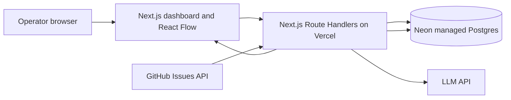

# FlowMedic Live — Architecture

**Status:** Accepted blueprint; Phase 01/02 implementation in progress.  
**Last reviewed:** 2026-10-28

## 1. Product goal and demo

Show a real integration recover safely from one bounded, understandable failure. FlowMedic fetches actual issues from a configured GitHub repository, normalizes a small allowlisted subset, and writes them into a dedicated managed Postgres database. In a dedicated demo environment, an operator deliberately changes a destination column name. A subsequent genuine SQL error is recorded as an incident. An LLM returns a structured candidate mapping. FlowMedic checks the candidate with deterministic policy, runs a non-mutating validation, asks a human to approve, then retries idempotently and verifies the saved row.

The LLM never executes SQL, changes schema, edits code, chooses arbitrary columns, or bypasses approval. The product claims repair of this supported field-mapping drift case only.

## 2. Deployment boundary

One Next.js App Router codebase and one Vercel project contain the UI and server-side Route Handlers. GitHub, the LLM provider, and Neon/Postgres remain external managed services; “single service” means one application deployment, not that Vercel hosts those vendors. No separate self-managed API server, worker, or database server is required.

## 3. Stack

| Area | Choice | Boundary |
|---|---|---|
| App | Next.js App Router + TypeScript | One deployable application |
| Server APIs | Route Handlers, Node.js runtime | Authenticated, bounded requests |
| UI | React, Tailwind CSS, shadcn/ui | Server Components by default; client components for graph/interactions |
| Workflow graph | React Flow | Visualizes persisted execution/step state; not source of truth |
| Source | GitHub REST API, issues endpoint | Read-only, least-privilege token |
| Destination and operational state | Neon Postgres provisioned through Vercel integration | External managed database with pooled connection URL where available |
| Diagnosis | LLM API with JSON/schema-constrained output | Proposal only; never an execution authority |
| Hosting | Vercel | Static/UI delivery plus serverless Route Handlers |

Use the currently supported, pinned Next.js/React/Node versions selected at project setup; this document intentionally does not freeze version numbers. Use parameterized SQL and a maintained PostgreSQL driver compatible with Vercel serverless execution. Neon’s serverless driver is an appropriate option for short-lived HTTP queries; prefer Neon’s pooled connection string for drivers using connections, and keep functions close to the database region. Validate the driver and transaction pattern against the selected runtime during Phase 00/01.

## 4. End-to-end flow

1. An authenticated operator clicks **Run workflow**, or a signed GitHub webhook triggers the same run-creation path. Manual trigger is the required MVP; webhook is optional if time remains. Scheduled polling is optional and must be plan-aware.
2. The server validates repository configuration and creates a workflow run with the caller's unique idempotency key. The Phase 01 manual route fetches at most two pages of 50 GitHub issues, excluding pull requests.
3. Input is normalized to stable fields (`external_id`, `number`, `title`, `body`, `state`, `html_url`, `updated_at`). Phase 01 bounds each issue body to 4,000 characters and the whole sync to 100 issues.
4. Each issue is upserted into the demo destination using a stable key (`source`, `repository`, `external_id`). The initial schema includes `issue_title`.
5. The demo operator uses a documented, explicit demo-only SQL migration/action to rename `issue_title` to `title`. The application itself must never mutate production schema. A fresh sync then issues an insert/upsert against the old column, producing a real PostgreSQL undefined-column error. Capture SQLSTATE and sanitized statement context, not credentials or unrestricted query text.
6. The failed step, workflow run, and incident are persisted through bounded database statements with a safe payload snapshot, error fingerprint, occurrence count, and status `detected`. Each statement is atomic; the Phase 02 implementation does not claim a multi-statement transaction across the whole sync.
7. Diagnosis sends only the minimum redacted evidence and known allowlisted schema metadata to the LLM. The response must match a strict schema such as `{diagnosis, mappings:[{sourceField,targetField}], confidence, rationale}`. Store model/provider, prompt version, response, and latency with the incident.
8. A deterministic validator rejects unknown source fields, unknown target fields, type-incompatible mappings, duplicate targets, unsafe identifiers, and mappings outside the fixed demo allowlist. It cannot turn model text into executable SQL. The server constructs SQL only from trusted identifiers in code and parameterizes values.
9. A dry-run validation checks the target column exists, payload types fit, and the mapping covers required fields. It does not write or change schema. The UI shows evidence and exact proposed mapping.
10. An authenticated human approves or rejects the versioned proposal. Approval records actor, timestamp, proposal hash, and incident version. Stale approvals fail closed.
11. Replay uses the approved mapping and original idempotency key. A unique constraint/upsert prevents duplicates. Attempt count and bounded retry policy prevent loops. Success is independently read back and verified before marking the incident `recovered`.
12. The graph, incident timeline, step outcomes, approval, retry, and repair-memory reference render from persisted server state. UI polling refreshes status until terminal state; do not rely on WebSockets being hosted by a Vercel Function.

## 5. State model and data

Suggested initial tables (migration-owned):

- `workflow_runs`: `id`, trigger, repository, status, idempotency key unique, started/finished timestamps, summary.
- `workflow_steps`: run FK, sequence, step key, status, started/finished timestamps, duration, safe input/output summary, error code/fingerprint.
- `github_issues`: source/repository/external ID unique, normalized fields, source updated time, sync timestamps. Keep demo-specific target schema isolated.
- `incidents`: run/step references, status, error metadata, sanitized payload JSON, fingerprint, attempts, created/updated timestamps, version.
- `repair_proposals`: incident/version, provider/model/prompt version, structured proposal JSON, validation results, confidence, status, created timestamp.
- `approvals`: proposal FK, actor, decision, approved hash, timestamp, comment.
- `repair_memory`: signature (source + error class + schema fingerprint), validated mapping JSON, successful/rejected counts, last used; only successful human-approved repairs become reusable.
- `audit_events`: append-only application events, actor/system identity, action, subject, timestamp, correlation ID, safe details.

Use UTC timestamps, foreign keys, check constraints for status enums, bounded JSON payloads, and indexes for run/incident timelines. Keep secrets and raw authorization headers out of all database rows. Define retention and deletion behavior before using non-demo repositories; the hackathon default should retain only what the demo needs.

Incident lifecycle: `detected → diagnosing → proposal_ready → validating → awaiting_approval → replaying → recovered`; terminal alternatives `rejected`, `validation_failed`, `replay_failed`, `cancelled`. State transitions are server-validated, versioned, and audited.

## 6. API surface (initial contract)

All operator routes require authentication and CSRF/origin protections appropriate to the auth mechanism. Return a correlation ID and stable error envelope; do not expose stack traces or credentials.

| Method/path | Purpose |
|---|---|
| `GET /api/health` | Liveness/config sanity only; no secret values |
| `GET /api/runs` | Paginated run summaries |
| `POST /api/runs` | Create a durable manual run; accept request idempotency key |
| `GET /api/runs/:id` | Read run and step status |
| `GET /api/runs/:id/events?after=<cursor>` | Read ordered persisted progress events after a cursor |
| `POST /api/runs/:id/advance` | Claim and execute only the next eligible bounded step; server controls ordering |
| `GET /api/incidents` / `GET /api/incidents/:id` | List/read incident, proposal, timeline |
| `POST /api/incidents/:id/diagnose` | Start/retry bounded diagnosis with dedupe guard |
| `POST /api/incidents/:id/validate` | Validate stored proposal; no write to destination |
| `POST /api/incidents/:id/approve` | Approve/reject exact proposal version/hash |
| `POST /api/incidents/:id/replay` | Replay only an approved, valid proposal |
| `POST /api/webhooks/github` | Optional signed webhook; verify HMAC and dedupe delivery ID |
| `GET /api/cron/poll` | Optional protected scheduled poll; verify `CRON_SECRET` |

## Step-by-step progress contract

For trustworthy live progress on Vercel, model the visible workflow as short, server-controlled steps rather than one detached background promise. `POST /api/runs` creates and returns a durable run ID. The authenticated UI controller then calls `POST /api/runs/:id/advance` to request the next eligible step; the server determines which step is next, validates state and version, claims it with a short database lease, persists `running` and `started_at`, performs exactly one bounded unit of work, and persists `succeeded`, `failed`, or `awaiting_approval` plus safe output before responding. The browser advances only after the server response, while polling `GET /api/runs/:id` or `/events?after=<cursor>` for active status, elapsed time, and new events. The client never supplies authoritative step status.

This keeps each invocation bounded and makes the step rail reflect database facts. If the tab closes, the durable run remains resumable; reopening can continue from the next eligible step. A lease-expiry/reconciliation path handles abandoned `running` steps conservatively and records recovery in the audit log. For a long single step, persist its active status first; the UI shows the real active step and elapsed time, not a fabricated percentage. Never rely on fire-and-forget work after returning the HTTP response.

### Phase 03 model boundary

The Phase 03 diagnosis endpoint sends only a bounded incident summary, code-owned schema-drift fields, and destination column metadata. It omits issue bodies and raw database error text. The model uses a strict structured-output schema and has no tools. Its proposal is still untrusted: deterministic code validates the one supported mapping (`issue_title → title`), actual target existence/type, duplicate targets, safe identifiers, and required-column coverage before saving the validation result. This phase performs no writes to the destination table and does not execute model-provided SQL.

## 7. Safety and security requirements

- Keep GitHub token, LLM key, `DATABASE_URL`, auth secrets, webhook secret, and `CRON_SECRET` server-only. Never prefix with `NEXT_PUBLIC_`; never return them to the browser or log them.
- Use a dedicated demo repository and dedicated disposable database/branch. Never demonstrate schema changes against personal or production data.
- Use GitHub minimum read-only repository permission for issues; constrain repository to configured owner/name.
- Authenticate the dashboard and authorization actions. Enforce same-site/CSRF protections for cookie sessions; rate-limit expensive routes and cap issue page size, payload, LLM tokens, and attempts.
- Verify webhook signatures against the raw body, reject stale/invalid signatures, and deduplicate delivery IDs. Manual run endpoint also requires auth.
- Redact tokens, URLs containing credentials, email/personally identifying content where feasible, and large bodies before LLM calls. Minimize prompts and set retention.
- Treat GitHub issue text, error messages, and LLM output as untrusted data and prompt injection. No tool execution from issue contents. JSON parse + schema validation + allowlist are mandatory.
- Repair allowlist is explicit source-to-target field pairs and compatible types. Reject SQL fragments, arbitrary identifiers, DDL, expressions, and unknown fields. AI never emits executable SQL.
- Approval binds to immutable proposal hash, incident version, validation result, and action scope. Replay rechecks all conditions server-side and records actor/time.
- Parameterize values, quote only code-owned validated identifiers, enforce database least privilege, and keep migrations separate from runtime credentials where possible.
- Audit every trigger, diagnosis, validation, approval/rejection, retry, state transition, and terminal result. Redact audit details.

## 8. Idempotency, concurrency, and retries

Use a unique key per trigger (for example `github:<repo>:<delivery-id>` or `manual:<request-uuid>`), unique external issue key, and unique `(incident_id, attempt_number)`. Claim work with an atomic database transition or short-lived lock/lease; reject overlapping active syncs or serialize them. Every transition checks current state/version. Retry only transient network/5xx/rate-limit failures with bounded exponential backoff and respect `Retry-After`; do not retry deterministic schema errors blindly. One approved replay is the only repair replay. Vercel Cron may be delivered more than once and does not retry failed invocations automatically, so state-level dedupe and visible failure status are required.

## 9. Serverless/Vercel constraints

- Route Handlers execute as Vercel Functions with plan-specific duration and resource limits. Set and verify `maxDuration` for relevant routes against the actual account plan; do not design the demo around an assumed limit.
- Keep one run bounded (small page, timeouts on GitHub/LLM/DB calls, bounded retries). A function timeout must leave persisted state resumable/failed, never silently “successful.”
- Do not use local filesystem for durable state, process memory for locks, in-process queues, or non-awaited background work.
- Use pooled Postgres connections and align Vercel function region with the Neon database region. Handle cold starts and connection pressure.
- Hobby Cron scheduling is limited to once daily and hourly precision; frequent poll requires suitable plan. Therefore MVP is manual trigger; optional webhook is event-driven. Cron, if enabled, is a convenience, not a correctness mechanism.
- Functions are not WebSocket servers. Use browser polling with backoff for live status; streaming is optional and must respect invocation lifetime.
- Cron routes must verify `CRON_SECRET`; cron can overlap and duplicate events. Use DB locking/leases and idempotency.
- Set per-service timeouts, request size limits, and observability correlation IDs. Inspect deployed function logs and plan limits during deployment.

## 10. UI scope

Single operator dashboard: system connection/status cards; React Flow graph (`GitHub → Normalize → Map/Validate → Postgres`); run history; focused incident timeline; actual error and sanitized payload; diagnosis and mapping proposal; validation status; explicit Approve / Reject controls; replay outcome and audit view. Graph state is a presentation of persisted run state, not a fabricated animation. Include loading, empty, stale, running, blocked, and error states. Demo data may populate visual examples only if clearly labeled and separate from real run status.

## 11. Observability and operational behavior

Structured logs include request/run/incident/step IDs, route, duration, outcome, provider status, and error fingerprint; exclude secrets, raw tokens, full issue bodies by default, and raw SQL parameters. Persist audit events and step timings. Provide health/config diagnostics that report configured/missing names only. Track sync count, failures by class, diagnosis latency, approval wait, replay success, and duplicate suppression. Add a “reset demo” runbook that only resets disposable demo records and requires explicit operator confirmation.

## 12. Definition of done

The core demo is done only when deployed preview/prod can (1) fetch real configured GitHub issues, (2) upsert and verify them in managed Postgres, (3) reproduce a real undefined-column error in the isolated demo schema, (4) persist incident evidence, (5) return a schema-valid AI proposal, (6) reject unsafe proposal examples, (7) require explicit approval, (8) replay with the approved mapping without duplicates, (9) verify destination row and show persisted timeline, and (10) provide a documented reset and contingency demo. See phase exit criteria for evidence.
